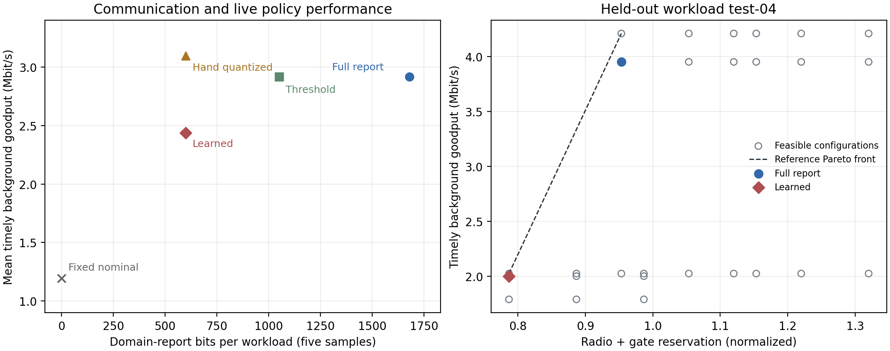

# EXP-13 三域帕累托编排与状态上报压缩

## 实验目的

用现有日字形仿真检验两件事。第一，外部全局控制器能否根据域级上报挑选出接近全量离散枚举的可行配置，并通过已有三域接口落实。第二，在同一个全局求解器下，阈值上报、手工量化和学习编码各能少传多少比特，又会怎样影响端到端业务。

本轮使用一条下行业务路径 server → UPF → NE1 → NE3 → NE5 → gNB1 → UE0。三域均沿用已验证的执行器。首轮各域可选动作由离散配置表提供。无线在各自时隙内继续运行原生 MAXCI，承载网继续按本地门表调度，UPF 用令牌桶执行速率。域内生成候选和反复下发属于下一轮实验。

## 参数与方法

| 项目 | 配置 |
| --- | --- |
| 仿真总时长 | 3 s，应用在原场景 1.6 s 停止发包，保留排空期 |
| 业务 | 200 B 控制包每 5 ms 发送，背景包负载 1000 B，突发前间隔 8 ms |
| 突发 | 0.60–1.00 s，间隔按工作负载参数变化 |
| 域上报 | 580、600、620、640、660 ms，各域可用近几个样本的历史 |
| 唯一决策 | 660 ms，前缀配置固定为 20 Mbit/s、600 µs、4 个逻辑频带 |
| UPF 候选 | 2、4、20 Mbit/s |
| Qbv 候选 | 5 ms 周期内优先级开门 600、1100、1600 µs |
| gNB 候选 | 每次下行调度可用 4、5、6 个逻辑频带 |
| 训练工况 | 24 个，400 m 内三个 UE 位置、两个以太网速率 10/100 Mbit/s、四个背景突发间隔 500/850/1400/2400 µs 的全组合，随机种子 0 |
| 留出测试 | 8 个，650/1100/1900/2800 µs 各与两种配置组合。配置一为 UE x=170 m、10 Mbit/s、seed 1，配置二为 UE x=345 m、100 Mbit/s、seed 2 |

每个工况都通过外部 TCP 控制器实际执行 27 种联合配置，得到 864 次参考仿真。检查 27 种配置的决策前状态完全一致，并核对回执中的三个实际配置。然后在 8 个留出工况上实际下发五种控制策略选出的动作，共 40 次。运行时的选法只读取通过编码方式收到的状态，拟合时只使用训练工况的参考数据。每次在线下发的逐包指标都与该工况对应的参考配置一致。

统计 0.66–1.00 s 内发送的包。关键流 SLA 定为至少 95% 在 20 ms 内到达，未到包计为违约。背景流用 100 ms 内送达的应用负载计算有效吞吐。全局前沿在满足关键流 SLA 的解里最大化背景流按期吞吐、最小化归一化预留开销。开销定义为无线预算除以 6，加上高优先级窗口除以 5000 µs。在线选择限定开销≤1.22，在该范围内最大化预测背景流按期吞吐。集中式参考用各工况 27 个实测配置和同一个选择规则。

全局求解器用三个加权最近邻预测联合配置的时限送达率和按期吞吐，各组使用同一模型和同一候选表。两种压缩组的域消息均为 4 字节首部加 1 字节负载。首部包含版本、域号和观测序号。统计本机 socketpair 实际交换的应用层上报帧，记录的位数包含这个首部，码本预先共享。仿真器与外部控制器之间沿用原有 localhost TCP/JSON。后者的流量、动作下发、回执、码本部署和实际链路封装各有独立开销，本轮位数只对应域上报链路的模型。

| 方法 | 实验原理和验证目的 |
| --- | --- |
| 固定常态 | 保持初始配置，用于衡量不做跨域选择时的业务结果 |
| 全量 | 每个时刻发送三个域的完整二进制状态摘要，作为压缩前的预测决策基线 |
| 阈值 | 每域相对上一次上报，当归一化字段变化达到 0.20 或满 60 ms 才重发全量摘要，验证减少上报频次的影响 |
| 手工量化 | 每域用两个 4 比特字段提取负载、队列和域配置等特征，同样的包长下作为简洁的非学习基线 |
| 学习编码 | 每域训练最多 16 个码字的向量量化码本，三个域最终使用 14、11、16 个码字。用训练负载中各联合动作的真实指标相关性对字段加权，编码端发码字索引，解码端还原近似状态。验证学习表示是否比手工量化保留了更多决策信息 |

## A100 实测结果

| 方法 | 五次采样平均上报比特 / 工况 | 平均背景流按期吞吐（Mbit/s） | 实际选中参考前沿 | 20 ms SLA 工况达标 |
| --- | ---: | ---: | ---: | ---: |
| 固定常态 | 0 | 1.194 | 2/8 | 8/8 |
| 全量 | 1680 | 2.918 | 4/8 | 8/8 |
| 阈值 | 1050 | 2.918 | 4/8 | 8/8 |
| 手工量化 | 600 | 3.097 | 6/8 | 8/8 |
| 学习编码 | 600 | 2.435 | 4/8 | 8/8 |

相同资源开销上限下，参考枚举的平均背景流按期吞吐为 3.162 Mbit/s。阈值法在 8 个工况的动作完全等同于全量法，上报位数少 37.5%。两种量化方法都少 64.3%。手工量化距参考解平均少 0.065 Mbit/s，学习编码少 0.726 Mbit/s。学习编码在两个 1900 µs 的测试工况选择了 4 个逻辑频带，全量和手工量化选择 5 个，真实背景流按期吞吐分别约为 2.00–2.05 Mbit/s 和 3.95 Mbit/s。留出样本只有 8 个，结果支持在这组场景中比较取舍。

20 ms 主实验中，五种方法均实现关键流 544/544 按期到达，所有测试工况的 27 个动作也都达到关键流门槛。因此本轮的差异主要体现在背景吞吐与预留资源。对已执行的同一批包用 10 ms 时限重新评分，95% 门槛的工况达标数依次为固定 7/8、全量 5/8、阈值 5/8、手工 6/8、学习 6/8。这个事后诊断仅用于检查 SLA 敏感性。

一轮 4 并发复跑中，四个在线上报方法的本机控制桥等待决策 P99 约为 1.1–1.9 ms，每种方法仅计 8 个最终决策。仿真时钟在等待期间暂停，该数值用于调试编码和求解开销，实际的分布式下发时限还需异步控制链路验证。两次在线复跑得到完全一致的动作、位数、前沿和业务指标，墙钟时间有波动。



## 复跑

A100 使用 Python 3.12、NumPy 1.26.4、Matplotlib 3.6.3。

```bash
cd /media/a100/data/zbw/nasctime
source omnetpp-6.4.0/setenv
export LD_LIBRARY_PATH="$PWD/../conda-envs/nasctime/lib:$PWD/omnetpp-6.4.0/lib"
export INET_ROOT="$PWD/inet" SIMU5G_ROOT="$PWD/Simu5G"
export OPENBLAS_NUM_THREADS=1 MPLBACKEND=Agg
make -C Simu5G/src -j6
make -C nascTime -j4
base=$(mktemp -d /tmp/ladder-pareto.XXXXXX)
python3 -B experiments/exp/ladder_pareto_probe.py "$base/reference" --jobs 10
python3 -B experiments/exp/ladder_pareto_replay.py "$base/reference/oracle.json" "$base/replay" --jobs 4
python3 -B experiments/exp/ladder_pareto_report.py "$base/reference/oracle.json" "$base/replay"
```

提交保存配置、数据生成器、编码器、回放器和出图脚本。本地压缩包包含 864 个配置测出的参考指标、40 次实际下发的回执和 OMNeT++ 原始应用向量、模型码本、按工况结果及 10 ms 诊断 CSV。学习组件当前以输出指标相关性训练码本，互信息目标、连续决策和域间异步时序尚待单独验证。
